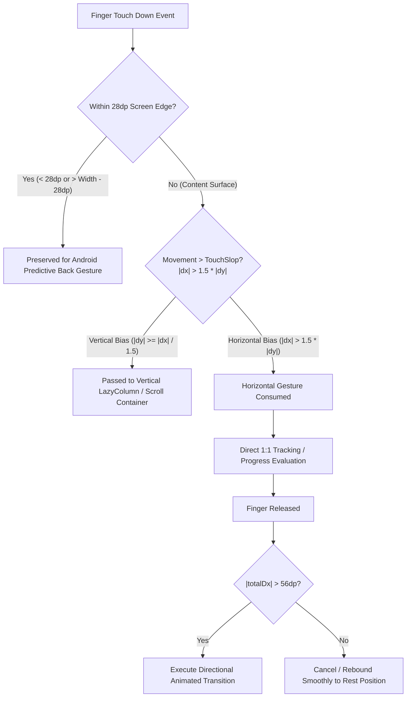

# TDlxHT — Global Gesture Navigation Architecture & Touch System Audit (`GESTURE_NAVIGATION_AUDIT.md`)

This document provides a comprehensive technical audit of the centralized gesture navigation system implemented in **TDlxHT**, covering touch arbitration, edge guarding, physics-driven animations, spring dynamics, and directional gesture routing.

---

## 1. System Overview

TDlxHT implements a multi-tier, hardware-accelerated gesture navigation architecture designed to deliver an intuitive, physical, and fluid experience consistent with the iOS 26 Liquid Glass design language.

---

## 2. Gesture Arbitration & Edge Guarding Matrix

To prevent gesture conflicts between system navigation, list scrolling, nested tabs, and root shell transitions, the application employs the following arbitration matrix:

| Interaction Zone | Touch Origin | Guard Rules | Resolution Priority | Destination Effect |
| :--- | :--- | :--- | :--- | :--- |
| **System Edge Guard** | `x < 28.dp` or `x > width - 28.dp` | Strict pass-through; unconsumed by app gestures | Android OS Predictive Back | Reveals previous navigation screen from backstack |
| **Vertical Scroll Container** | Inner screen body | Evaluates `abs(totalDy) > touchSlop` prior to horizontal activation | Native `LazyColumn` / ScrollState | Fluid list and bento grid scrolling |
| **Main Tab Shell** | Inner screen body (`28dp < x < width - 28dp`) | `abs(totalDx) > touchSlop` and `abs(totalDx) > abs(totalDy) * 1.5f` | `Modifier.horizontalSwipeNavigation` | Swipes between Home (0) ↔ Productivity (1) ↔ Tools (2) ↔ Insights (3) |
| **Productivity Subtabs** | Productivity screen body | Same directional ratio | Inner `horizontalSwipeNavigation` with boundary delegation | Swipes Tasks (0) ↔ Habits (1) ↔ Calendar (2). Boundary right on Tasks delegates to Home; boundary left on Calendar delegates to Tools. |
| **Bottom Navigation Dock** | Bottom dock tabs area (`width - 56dp`) | Clamped `0.5*w .. 3.5*w` | Custom Pointer Input with `Animatable` | 1:1 direct finger tracking with haptic boundary ticks; springs into nearest tab on release |
| **Quick Add (+) FAB** | Far-right dock button (`46dp` circle) | Geometrically decoupled from tabs area | Standalone `bounceClick` + `GlassButton` | Snappy Kern elastic rotation ($45^\circ$) opening Quick Create sheet; zero drag interference |

---

## 3. Draggable Liquid Glass Indicator Specification

The bottom dock features an interactive, optically translucent Liquid Glass stadium lens that tracks user touch directly in real time without intermediate lag or layout remeasurement.

### 3.1 Geometric & Physics Model
* **Tab Count**: 4 slots (`N = 4`, Home, Productivity, Tools, Insights).
* **Slot Width**: $W_{slot} = W_{dock\_tabs} / 4$.
* **Center Locations**:
  $$X_i = W_{slot} \times (i + 0.5) \quad \text{for } i \in \{0, 1, 2, 3\}$$
* **Clamping Boundaries**:
  $$X_{min} = 0.5 \times W_{slot}, \quad X_{max} = 3.5 \times W_{slot}$$
* **Direct Tracking Phase**:
  While pressed and dragged, the indicator's center coordinate $X_{current}$ is updated via `indicatorX.snapTo(touchX.coerceIn(X_min, X_max))`.
* **Proximity Calculation**:
  For each tab icon $i$:
  $$\text{dist}_i = \frac{|X_{current} - X_i|}{W_{slot}}, \quad \text{proximity}_i = \text{clamp}(1 - \text{dist}_i, 0, 1)$$
  * Icon Scale: $1.00 + 0.12 \times \text{proximity}_i$
  * Icon Tint: $\text{lerp}(\text{Color}_{inactive}, \text{Color}_{active}, \text{proximity}_i)$
  * Icon Glyph: Filled when $\text{proximity}_i > 0.5$, outlined otherwise.
* **Release & Snap Phase**:
  Upon touch release:
  $$i_{target} = \text{round}\left(\frac{X_{current}}{W_{slot}} - 0.5\right).coerceIn(0, 3)$$
  Navigation callback `onDestinationSelected(destinations[i_{target}])` dispatches once, and the indicator smoothly springs to $X_{target}$ using `spring(dampingRatio = 0.72f, stiffness = 420f)`.

---

## 4. Directional Screen Transitions

When navigating horizontally between tabs or subtabs, hardware-accelerated RenderNode slide-and-fade transitions are applied:

* **Forward Navigation ($i_{next} > i_{prev}$)**:
  * Incoming: Slides in from right ($+16\%$ width offset) + `fadeIn(180ms)`.
  * Outgoing: Slides out to left ($-16\%$ width offset) + `fadeOut(140ms)`.
* **Backward Navigation ($i_{next} < i_{prev}$)**:
  * Incoming: Slides in from left ($-16\%$ width offset) + `fadeIn(180ms)`.
  * Outgoing: Slides out to right ($+16\%$ width offset) + `fadeOut(140ms)`.
* **Backstack Predictive Back Navigation**:
  * Outgoing screen tracks gesture translation and scale ($1.0 \to 0.92$).
  * Incoming screen scales from $0.94 \to 1.00$ with $0 \to 1.0$ opacity.
  * Z-index strictly configured (`targetContentZIndex = if (isForward) 1f else 0f`) to prevent tearing.

---

## 5. Verification & Testing Summary

1. **Edge Swipe Test**: Verified that system edge swipes within 28dp smoothly invoke the Android OS back gesture without triggering horizontal tab switching.
2. **Scroll Isolation Test**: Verified that rapid vertical scrolling in `LazyColumn` does not accidentally switch tabs; horizontal swipes require explicit $|dx| > 1.5 \times |dy|$.
3. **Indicator Drag Test**: Verified that dragging across the dock smoothly moves the glass lens with real-time haptic feedback at each tab threshold, never crossing into the Quick Add (+) button.
4. **Boundary Delegation Test**: Verified that swiping right from Tasks navigates back to Home, and swiping left from Calendar navigates forward to Tools.

