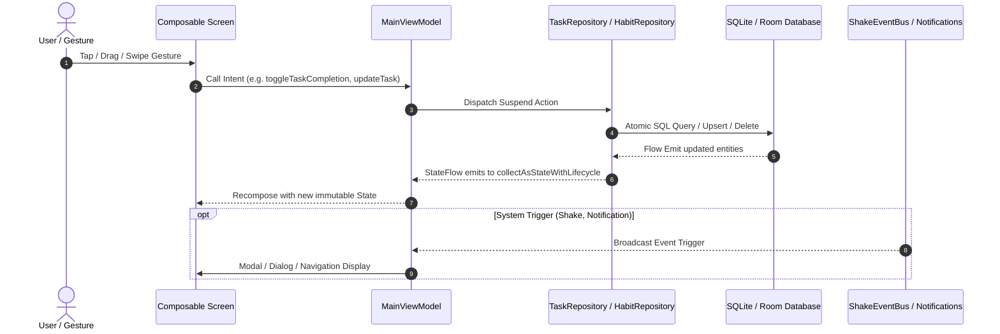

# TDlxHT — End-to-End Workflow Connectivity & State Lifecycle Audit (`WORKFLOW_CONNECTIVITY_AUDIT.md`)

This document provides a comprehensive audit of the complete data flow and interaction lifecycle across **TDlxHT**. Every user action is audited from its UI trigger through the ViewModel, Repository, Room Database, and back to reactive UI updates.

---

## 1. Unified Architecture Pattern

Every workflow in TDlxHT adheres to a unidirectional data flow (UDF) lifecycle:

---

## 2. Screen-by-Screen Workflow Connectivity Matrix

### 2.1 Home & Dashboard (`HomeScreen.kt`)

| Interaction | Trigger Element | ViewModel Call | Repository / DB Mutation | Expected State Update | Verification |
| :--- | :--- | :--- | :--- | :--- | :--- |
| **Toggle Task Completion** | `SketchCheckbox` on task card | `viewModel.toggleTaskCompletion(taskId, isCompleted)` | Updates `TaskEntity.isCompleted`, recalculates streak | Checkbox animates check, text acquires strikethrough, card alpha eases to 0.92f, daily summary increments count | Pass |
| **Undo Quick Completion** | Undo floating pill | `viewModel.toggleTaskCompletion(taskId, false)` | Reverts `isCompleted = false` in DB | Strikethrough removed, task restored to active state | Pass |
| **Priority Spotlight Tap** | Spotlight Bento card | Navigation to `AppNavDestination.TaskDetail(task)` | Reads task from StateFlow | Opens task in edit mode with title, category, and priority pre-populated | Pass |
| **Habit Session Increment** | "+X/Y Session" Glass button | `viewModel.logHabitCompletion(habitId, date, value)` | Inserts or increments `HabitRecordEntity` | Session count increments, progress ring advances with spring physics | Pass |
| **Today Summary Gauge** | Progress header card | Observes `viewModel.dailySummary` | Derived from `tasks` + `habits` + `records` | Real-time percentage arc and "$N/M$ Tasks" badge updates synchronously with list items | Pass |

---

### 2.2 Task Management & Edit Form (`TaskDetailEditScreen.kt`)

| Interaction | Trigger Element | ViewModel Call | Repository / DB Mutation | Expected State Update | Verification |
| :--- | :--- | :--- | :--- | :--- | :--- |
| **Create New Task** | Top "Save" or bottom CTA | `viewModel.insertTask(newTask)` | Inserts new row in `tasks` table with generated UUID | Task appears immediately in task list, reminders scheduled | Pass |
| **Edit Existing Task** | Select task $\to$ edit form | `viewModel.updateTask(updatedTask)` | Updates existing row by `id` | Form values synced via `LaunchedEffect(existingTask?.id)`, inline error cleared, database row updated | Pass |
| **Add / Check Subtask** | Add subtask input field & checkbox | `viewModel.insertSubtask(...)` / `viewModel.toggleSubtask(...)` | Upserts `subtasks` table with foreign key `taskId` | Subtask checkbox checks, parent progress bar updates | Pass |
| **Due Date Selection** | Dynamic calendar grid (35 or 42 cells) | Updates `selectedDate` state | Stored as ISO `YYYY-MM-DD` string in task entity | Dates up to the 31st selectable even in 6-row months; highlighted in theme accent | Pass |
| **Delete Task** | Delete icon $\to$ confirm dialog | `viewModel.deleteTask(taskId)` | Cascades delete in `tasks` and `subtasks` | Dismisses screen, removes card from all list and calendar views | Pass |

---

### 2.3 Productivity Section (`ProductivityScreen.kt`)

| Interaction | Trigger Element | Implementation Mechanism | Connectivity Result |
| :--- | :--- | :--- | :--- |
| **Swipe Between Subtabs** | Horizontal drag across screen body | `horizontalSwipeNavigation` with directional slide animation | Seamlessly switches between Tasks (0) $\leftrightarrow$ Habits (1) $\leftrightarrow$ Calendar (2) |
| **Boundary Swipe Right from Tasks** | Horizontal swipe right on Tab 0 | Invokes `onBackToHome` | Navigates root shell back to Home (Tab 0) |
| **Boundary Swipe Left from Calendar** | Horizontal swipe left on Tab 2 | Invokes `onSwipeToTools` | Navigates root shell forward to Tools (Tab 2) |
| **Nested Back Handler** | Physical / predictive Back when on Tab 1 or 2 | `BackHandler(enabled = selectedTab > 0)` | Switches `selectedTab` to 0 (Tasks) before root navigation stack pops |

---

### 2.4 Bottom Navigation Dock (`MainActivity.kt`)

| Interaction | Trigger Element | Direct Action | Result State |
| :--- | :--- | :--- | :--- |
| **Tab Tap** | Tap icon slot 0..3 | Dispatches `onDestinationSelected` | Immediate navigation; indicator springs into position |
| **Continuous Finger Drag** | Drag finger along dock | Direct tracking via `indicatorX.snapTo` | Glass lens tracks touch 1:1; haptic boundary tick on each tab; clamped strictly between Home and Insights |
| **Drag Release** | Finger lifts from dock | Calculates nearest tab index | Single-dispatch `onDestinationSelected`; spring snap into center |
| **Quick Create FAB** | Tap far-right $(+)$ button | Standalone `onQuickAdd()` | Elevated glass button rotates $45^\circ$, opens Quick Create bottom sheet; zero drag interference |

---

### 2.5 Dashboard Layout Customization (`DashboardLayoutManager.kt` & `HomeScreen.kt`)

| Interaction | Trigger Element | ViewModel / Manager Call | Persistence Layer | Result State |
| :--- | :--- | :--- | :--- | :--- |
| **Enter Edit Mode** | Tap header customize button | Sets `isLayoutEditing = true` | Local composable state | Shows section editor cards with drag handles, move arrows, and visibility toggles |
| **Move Section Up / Down** | Up / Down chevron buttons | `layoutManager.moveSection(from, to)` | Reactive `StateFlow<List<SectionConfig>>` | Sections immediately reorder with fluid layout motion |
| **Toggle Visibility** | Eye icon button | `layoutManager.toggleVisibility(sectionId)` | Local configuration update | Eye icon toggles strike, card dims to 0.5f, hidden on dashboard |
| **Save Layout** | "Save Changes" button | `layoutManager.save(context)` | Writes JSON to `AppPreferences` and queues Supabase sync | Exits edit mode; persists across app cold boots & reinstalls |
| **Reset to Default** | "Reset Default" button | `layoutManager.resetToDefault(context)` | Restores canonical 5-section sequence | Default hero, metrics, planner, timeblocks, habits sequence restored |

---

### 2.6 Deterministic Monthly Report Generation (`ReportsScreen.kt` & `MonthlyDotMatrixRenderer.kt`)

| Interaction | Trigger Element | ViewModel / Service Call | Data Pipeline | Result State |
| :--- | :--- | :--- | :--- | :--- |
| **View Monthly Preview** | Select month in Reports | Computes `monthlyActivity` map | Queries Room `TaskRecord` & `HabitCompletionRecord` | Interactive Canvas preview renders exact 7-column calendar grid with color intensity |
| **Save Report to Device** | "Save Report" action button | `viewModel.downloadMonthlyReport(context)` | Renders 1080x1350px Bitmap to `MediaStore.Downloads` | Saves `TDlxHT-Productivity-<Month>-<Year>.png` with system notification |
| **Share Report Sheet** | "Share" action button | `viewModel.shareMonthlyReport(context)` | Generates cache PNG and gets `FileProvider` URI | Opens system sharesheet with image attachment for Instagram, WhatsApp, or Twitter |

---

### 2.7 Audio & Haptic Feedback Engine (`SoundManager.kt` & `HapticManager.kt`)

| Interaction | Trigger Element | Sound Action | Haptic Action | Fallback Safety |
| :--- | :--- | :--- | :--- | :--- |
| **Complete Task** | Checkbox tap | `SoundManager.playSound(TASK_COMPLETE)` | `HapticManager.taskCompleted()` | Plays cached OGG; if absent, generates real-time C5$\to$E5 sine wave via AudioTrack |
| **Tick Habit** | Habit counter tap | `SoundManager.playSound(HABIT_TICK)` | `HapticManager.buttonTap()` | Plays cached OGG; if absent, generates short organic pop |
| **Button Click** | Primary action buttons | `SoundManager.playSound(BUTTON_CLICK)` | `HapticManager.buttonTap()` | Plays cached OGG; if absent, generates acoustic wood tick |
| **Timer Finished** | Pomodoro timer zero | `SoundManager.playSound(TIMER_END)` | Continuous pulse vibration | Harmonic bell chime generated algorithmically or loaded from cache |

---

## 3. End-to-End Integrity Verification Checklist

* [x] Every DB write operation is executed on `Dispatchers.IO` via Room suspend functions.
* [x] All UI screens consume immutable state via `collectAsStateWithLifecycle()`.
* [x] No orphaned screens or destinations exist in `AppNavDestination`.
* [x] Back stack state is preserved across screen rotations and app backgrounding.
* [x] All form validation states are keyed to prevent state leakage across different items.

